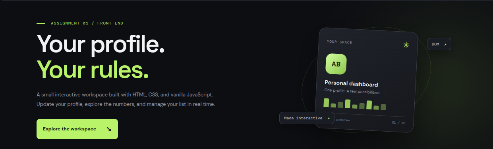
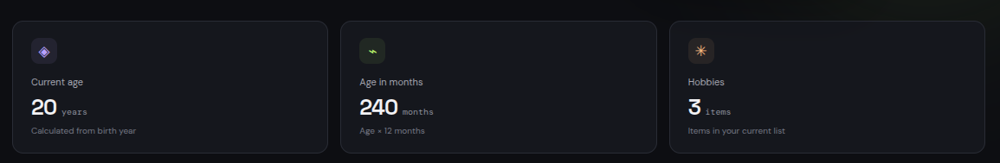
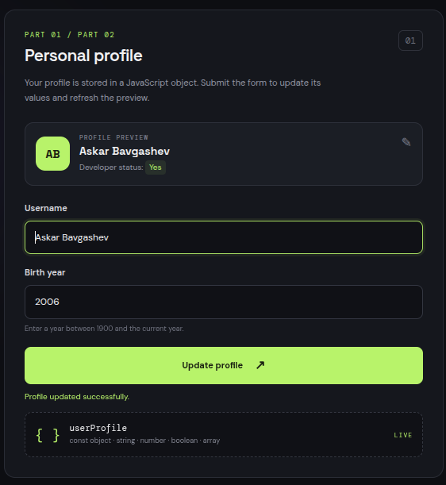
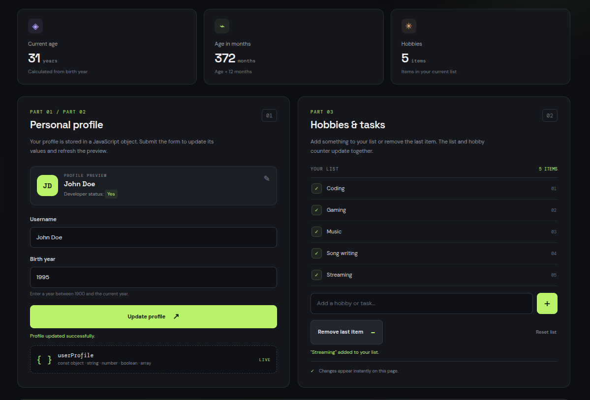
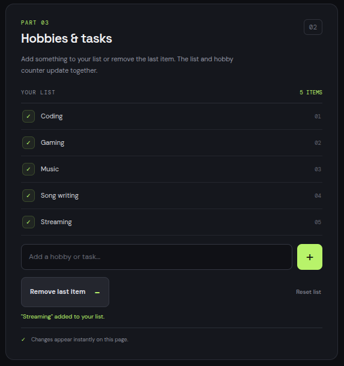

# Assignment #5 — JavaScript Basics (DOM Manipulation & Events)

**Student:** Askar Bavgashev  
**Group:** SE-2540  
**Course topic:** JavaScript Basics — DOM Manipulation & Events

## Project overview

Profile Lab is a responsive, dark-themed profile dashboard made with HTML, CSS, and vanilla JavaScript. It demonstrates JavaScript data types, arithmetic operators, form event handling, and dynamic DOM list manipulation.

## Assignment tasks

### Task 1 — The Personal Info Object

In `script.js`, the `const userProfile` object stores:
- `name`: string
- `birthYear`: number
- `isDeveloper`: boolean
- `hobbies`: array of strings

**Screenshot:**  

### Task 2 — Arithmetic Calculations

The page calculates the user's approximate age using the current year minus `birthYear`, estimates age in months using age multiplied by 12, and counts the items in the hobbies array. The results appear in the statistics cards and are also printed to the browser console.

**Screenshot:**  

### Task 3 — HTML Form Setup

**Screenshot:**  

### Task 4 — Event Listener

A `submit` event listener prevents the default page reload, reads the form values, validates them, and updates `userProfile`. The profile preview and statistics are refreshed after a valid submission.

**Screenshot:**

### Task 5 — Creating and Removing Elements

The hobbies/tasks section uses DOM methods to create and append `<li>` elements. The **Add Item** field adds a new entry, **Remove last item** removes the final entry, and **Reset list** restores the starter list. The item count updates automatically.

**Screenshot:**  

## Work process summary

1. Created the HTML structure for the profile dashboard, statistics, profile form, and hobbies list.
2. Styled the page with a responsive dark theme using CSS Grid and Flexbox.
3. Defined the `userProfile` object with a string, number, boolean, and array.
4. Added arithmetic calculations and console output for age, approximate age in months, and hobby count.
5. Added form submission handling, validation, and profile preview updates.
6. Used DOM methods and event listeners to add and remove list items dynamically.
7. Tested the page in a browser and prepared this report structure.

## Main files

- `index.html` — page structure and form elements.
- `style.css` — responsive dark theme.
- `script.js` — profile data, calculations, event listeners, and DOM updates.
- `screenshots/` — screenshots for the report.